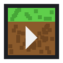
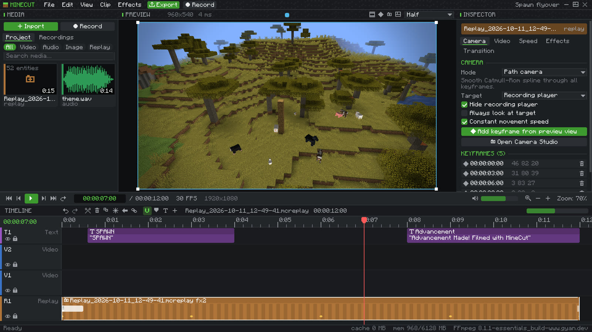
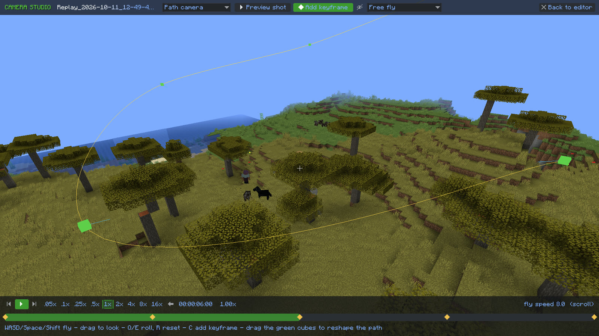
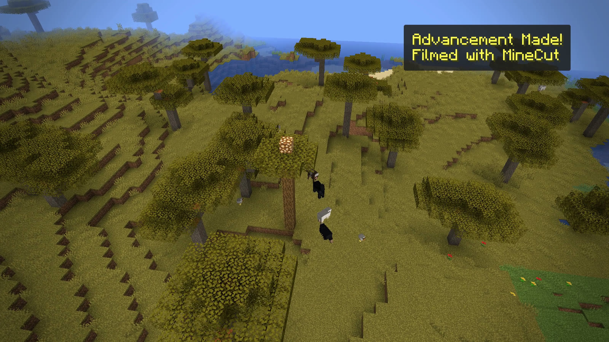
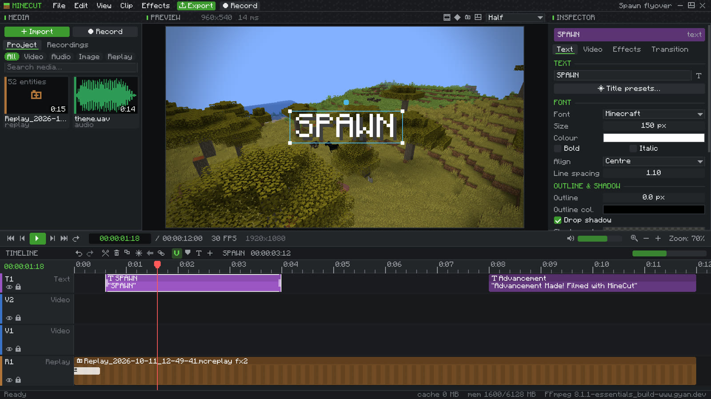
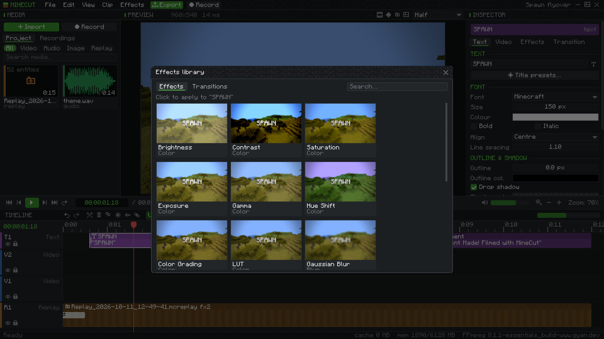
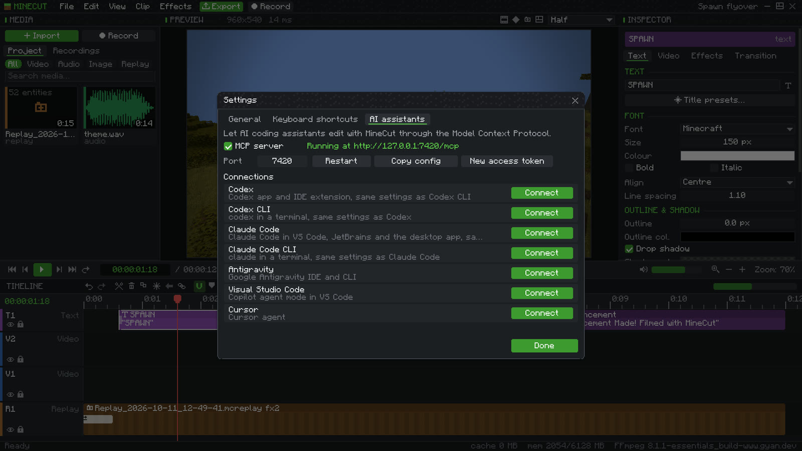

  

<h1 align="center">MineCut</h1>

  A video editor inside Minecraft. Record your world as a replay, fly a camera through it afterwards, 
  edit with music, titles and effects, and export the finished video without leaving the game.

  

  
  
  
  
  
  

  <a href="https://minecut.floppegg.workers.dev">Website</a> &nbsp;&nbsp;
  <a href="#install">Install</a> &nbsp;&nbsp;
  <a href="#features">Features</a> &nbsp;&nbsp;
  <a href="#ai-assistants">AI assistants</a> &nbsp;&nbsp;
  <a href="https://github.com/epikchadi-ctrl/minecut/issues">Report a problem</a>

## What it does

You press F7 and play. MineCut stores the world around you, every mob, block change and particle, so the footage is not locked to the angle you were looking from. Later you open the editor, drag the replay onto the timeline next to your own clips and music, and film it again from wherever you like.

| | |
|---|---|
|  |  |
| **Camera Studio.** Fly through the recording, drop keyframes and drag the path's control points in 3D. Plays from 0.05x to 16x, forwards or backwards. | **Export.** Every frame is rendered from the replay, mixed with your music and titles, and the file is checked before MineCut says it is done. |
|  |  |
| **Titles.** Minecraft font or any font on your computer, with outlines, shadows, panels and animations. | **Effects.** Colour grading, LUTs, blur, glow, grain and more, previewed on your own frame. |

## Install

1. Install [Fabric Loader](https://fabricmc.net/use/installer/) for Minecraft **1.21.1**, or create a Fabric 1.21.1 instance in Prism Launcher, Modrinth App or CurseForge.
2. Put [Fabric API](https://modrinth.com/mod/fabric-api/versions?g=1.21.1) for 1.21.1 and `minecut-0.6.0.jar` in the `mods` folder.
3. For video import, screen recording and export, install [FFmpeg](https://ffmpeg.org/download.html) and add its `bin` folder to PATH, or pick the folder later in MineCut settings. Replays work without it.
4. Start the game and join a world. Press **M** for the editor or **F7** to start and stop recording.

The download is also on the website: **[minecut.floppegg.workers.dev](https://minecut.floppegg.workers.dev)**.

## Features

**Recording**
- Screen video, replay data, or both at once
- Radius of 32, 64, 128, 256 blocks or your own
- Players, mobs, items, projectiles, equipment, animations, block changes, light, weather and time of day
- Works on servers with whatever the server sends to your client

**Camera**
- Free, path, dolly, orbit, follow, first person and third person
- Keyframes for position, rotation, roll, field of view, focus distance and depth of field
- Linear, smooth, bezier, Catmull-Rom and custom easing, plus constant-speed paths
- Slow motion re-simulates the replay instead of stretching frames

**Timeline**
- Video, replay, text, effect and audio tracks, as many as you need
- Trim, split, ripple delete, snapping, groups, linked audio and video, copy and paste
- Speed ramps, reverse and freeze frames
- Undo history, markers, in and out points, J K L playback, customisable shortcuts
- 24, 25, 30, 50, 60 and 120 fps with frame-exact timing

**Picture and sound**
- 16 effects and 8 transitions, adjustment layers and blend modes
- Keyframed volume and pan, fades, three-band EQ and normalising
- Imports MP4, MOV, MKV, WebM, MP3, WAV, OGG, FLAC, PNG, JPG and WebP
- SRT subtitles become editable captions

**Export**
- 720p, 1080p, 1440p, 4K or any size
- MP4, WebM or MOV with H.264, H.265, AV1 or VP9, depending on your FFmpeg
- Progress, time left, cancel, and a check of the finished file

**Projects**
- Autosave and recovery after a crash
- Your original files are never changed
- Relink moved media, or package a project with all its media to share it

## AI assistants

MineCut runs a small [MCP](https://modelcontextprotocol.io) server on your computer while the game is open. In **File > Settings > AI assistants** you can connect it with one click to:

- Codex and Codex CLI
- Claude Code and Claude Code CLI
- Antigravity
- Visual Studio Code
- Cursor

Your assistant can then read the timeline, import files, cut and move clips, set up camera moves, add titles and effects, start a recording, export, and look at the result through a preview frame. Other MCP servers already in those configs are left as they are, and each file is backed up before the first change.

The server only listens on `127.0.0.1` and refuses requests without its access token.

## Requirements

| | |
|---|---|
| Minecraft | Java Edition 1.21.1 |
| Loader | Fabric Loader 0.16 or newer, with Fabric API |
| Java | 21 |
| FFmpeg | Optional for replays, needed for video import, screen recording and export |
| Tested on | Windows 11 |

## Known limits

- Screen recording does not capture game audio. Add music in the editor.
- On servers, a replay contains only the area and entities the server sent to you.
- Clouds, stars and falling rain are not drawn in replays. Rain still darkens the sky.
- Replay particles are simulated forwards, so they reset when you jump around in the timeline.

## License

MineCut is free to download and use, including for videos you publish or earn money from. The source code is not published. See [LICENSE.txt](LICENSE.txt).

MineCut is not an official Minecraft product and is not approved by or associated with Mojang or Microsoft.
